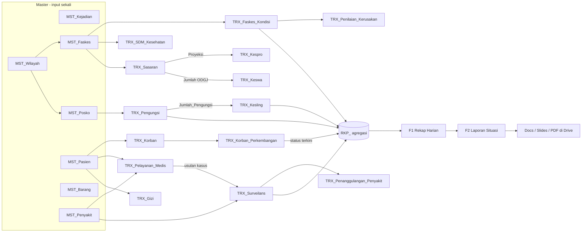
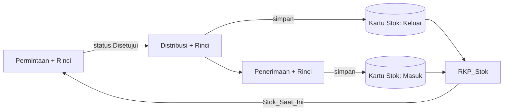
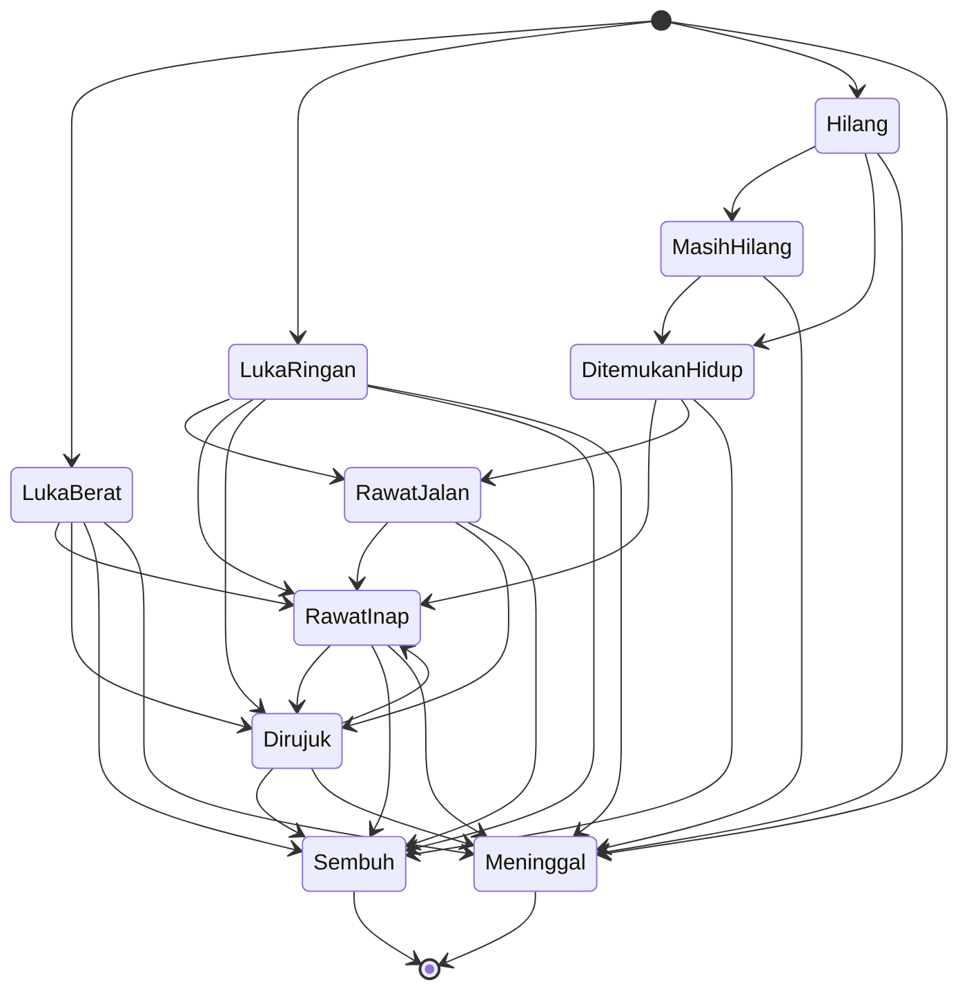

# PAKET PROMPT BERTAHAP — INDAKRIS NTT (Revisi 3)

Paket ini menggantikan prompt tunggal sebelumnya. Isinya:

- **Bagian 0:** Cara pakai dan keputusan strategi (ringkasan vs diagram vs tahapan).
- **Bagian A:** Konteks Bersama. Ditempel di awal **setiap** sesi AI. Memuat ringkasan satu halaman, daftar 26 menu, diagram integrasi, standar Korban, acuan migrasi, standar login/password, dan daftar titik kritis teknis.
- **Bagian B:** Prompt Tahap 1–13. Dikerjakan **berurutan**, satu tahap per sesi.
- **Lampiran:** Format Serah Terima dan checklist akhir.
- **Berkas pendamping (dilampirkan bersama Bagian A pada tahap yang disebut):** Lampiran I `Pemetaan Migrasi Struktur Lama ke Baru` (Tahap 12) dan Lampiran J `Seed MST_Penyakit ICD-10` (Tahap 1 dan 12).

### Perubahan pada Revisi 3

| Perubahan | Lokasi |
| --- | --- |
| Lingkup data dan kepemilikan baris (menyelesaikan masalah Admin Posko pada menu berbasis posko): `ID_Faskes_Pengelola` pada `MST_Posko`, `ID_Faskes` di-stamp server, tipe lingkup F/P/K/R, `ScopeService` | **A9** |
| Entitas Faskes, Instansi, dan Gudang (`Kategori_Entitas`) | **A10** |
| Master penyakit ber-ICD-10 dengan seed dan alur verifikasi | **A11** |
| Status data migrasi = `Terverifikasi`, validasi massal oleh Admin Provinsi, `Tanggal_Snapshot` = tanggal harian | **A12** |
| Konsolidasi seluruh perubahan skema (Legacy_Data, MIG_IdMap, STG, kolom verifikasi, dll.) | **A13** |
| Tambahan di Tahap 0, 1, 3, 4, 5, 6, 7, 8, 9, 10, 12, 13 dan checklist akhir | Bagian B, L2 |
| Pemetaan migrasi Korban dan alat pemeriksa struktur lama | Lampiran I bagian 3.25 |

---

## BAGIAN 0 — CARA PAKAI DAN KEPUTUSAN STRATEGI

### 0.1 Alur kerja per sesi

1. Buka sesi baru di AI coding assistant.
2. Tempel **Bagian A** (utuh).
3. Tempel **Serah Terima** dari tahap sebelumnya (kosong untuk Tahap 1).
4. Tempel **satu** Prompt Tahap dari Bagian B.
5. Periksa hasil terhadap *Kriteria Selesai*. Jika lulus, minta AI membuat **Serah Terima** (format di Lampiran) dan simpan untuk tahap berikutnya.
6. Jangan melompati tahap. Jangan menggabungkan dua tahap dalam satu sesi.

### 0.2 Keputusan: ringkasan satu halaman, diagram, atau tahapan kecil?

**Keputusan: tahapan kecil sebagai kerangka utama. Ringkasan satu halaman dan diagram tidak dipilih sebagai alternatif, tetapi dilebur ke dalam Bagian A sebagai konteks bersama.**

| Opsi | Bila berdiri sendiri | Peran dalam paket ini |
| --- | --- | --- |
| Prompt tunggal besar (versi lama) | AI kehilangan konsistensi di tengah, keluaran terpotong, kode inti tidak lengkap, sulit diuji | Dipecah menjadi 13 tahap |
| Ringkasan satu halaman | Mudah dibaca, tetapi tidak bisa dieksekusi dan tidak menghasilkan sistem | Menjadi **A1**, pengingat tiap sesi baru |
| Diagram alur integrasi | Membantu memahami relasi, tetapi tidak memuat aturan, validasi, dan hak akses | Menjadi **A3**, acuan relasi yang wajib dipatuhi AI |
| **Tahapan kecil** | Setiap tahap bisa diuji sendiri, kesalahan ketahuan dini, konteks muat dalam satu sesi | **Kerangka utama** (Bagian B) |

Alasan utama: sistem ini punya 26 menu, 4 level akses, rantai logistik berstok, dan laporan otomatis. Kesalahan di fondasi (skema, auth) akan merambat ke semua menu. Pada tahapan kecil, fondasi dikunci dan diuji lebih dulu, lalu menu dibangun per kluster di atasnya.

---

## BAGIAN A — KONTEKS BERSAMA (tempel di setiap sesi)

### A1. Ringkasan satu halaman

**Peran AI:** Senior Full-Stack Engineer dan Google Apps Script (GAS) Specialist untuk sistem informasi kebencanaan dan kesehatan **INDAKRIS NTT**.

**Tujuan:** (1) satu sumber kebenaran, data master diinput sekali dan dirujuk lewat ID; (2) minim salah entry lewat isian otomatis read-only; (3) tabel ringkas 6–9 kolom, detail di modal; (4) skalabel.

**Stack (wajib):** GAS V8 dengan pola `Router → Controller → Service → Repository`; Google Sheets sebagai database; Google Docs/Slides untuk laporan; Google Drive untuk lampiran; HtmlService untuk frontend ringan, responsif, mobile-first; tanpa library eksternal berat.

**Empat level akses:** Admin Posko (data `ID_Faskes` sendiri), Admin Kabupaten (data `ID_Kabupaten` sendiri, memverifikasi), Admin Provinsi (semua kabupaten, memvalidasi), Super Admin (semua). Hak akses dan filter data **ditegakkan di server**, bukan hanya di UI.

**Alur status data:** `Draft → Diajukan → Terverifikasi (Kab) → Tervalidasi (Prov)` atau `Dikembalikan` (dengan `Catatan_Verifikasi`). Data berstatus `Terverifikasi`/`Tervalidasi` tidak dapat diedit atau dihapus oleh level di bawahnya. Delete selalu soft delete.

**Prefiks sheet:** `SYS_` sistem, `MST_` master, `REF_` referensi, `TRX_` transaksi, `RKP_` rekap otomatis, `STG_` staging migrasi. Dashboard dan laporan membaca `RKP_`, bukan `TRX_` mentah.

**Aturan emas:**
1. Nama, alamat, kecamatan, kabupaten tidak disimpan ulang di transaksi, hanya ID.
2. ID dibuat server (`LockService` + `SYS_Sequence`). Tidak pernah dari frontend.
3. `ID_Kabupaten`, `ID_Faskes`, dan peran user **selalu dibaca dari sesi di server**, tidak dari parameter klien.
4. Tidak ada ID spreadsheet atau nama kolom berposisi tetap di kode. Semua lewat `SYS_Registry` dan pemetaan header.
5. Kartu Stok adalah ledger append-only.
6. Master yang sudah dipakai transaksi tidak boleh dihapus, hanya dinonaktifkan.
7. Setiap baris transaksi punya **pemilik tunggal** (`ID_Faskes`) yang **di-stamp server** saat insert (A9). Filter Admin Posko selalu `ID_Faskes = ID_Faskes user`.
8. Data hasil migrasi berstatus `Terverifikasi` dan baru menjadi `Tervalidasi` lewat validasi massal Admin Provinsi (A12).

### A2. Daftar menu kanonik (poin 1: diseragamkan)

Prompt lama menyebut "23 menu", padahal nama yang tertulis berjumlah 24, ditambah 2 menu yang sudah ada di proyek (Korban, Perkembangan Korban). **Angka resmi: 26 menu data (24 menu baru + 2 menu existing).** Menu administrasi (A01–A05) dihitung terpisah.

| Kode | Menu | Sheet utama | Kluster | Tahap |
| --- | --- | --- | --- | --- |
| M01 | Pengungsi | TRX_Pengungsi | A | 6 |
| M02 | Faskes | TRX_Faskes_Kondisi | A | 6 |
| M03 | Penilaian Kerusakan Faskes | TRX_Penilaian_Kerusakan | A | 6 |
| M04 | SDM Kesehatan | TRX_SDM_Kesehatan | A | 6 |
| M05 | Sasaran Sub Klaster | TRX_Sasaran (format long) | B | 7 |
| M06 | Pelayanan Medis | TRX_Pelayanan_Medis | B | 7 |
| M07 | Penanggulangan Penyakit | TRX_Penanggulangan_Penyakit | B | 7 |
| M08 | Kesehatan Lingkungan | TRX_Kesling | C | 8 |
| M09 | Kesehatan Reproduksi | TRX_Kespro | C | 8 |
| M10 | Kesehatan Jiwa | TRX_Keswa | C | 8 |
| M11 | Pelayanan Gizi | TRX_Gizi | B | 7 |
| M12 | Promosi Kesehatan | TRX_Promkes | C | 8 |
| M13 | DVI | TRX_DVI | C | 8 |
| M14 | Dasar Permintaan | TRX_Permintaan | D | 9 |
| M15 | Rincian Permintaan | TRX_Permintaan_Rinci | D | 9 |
| M16 | Distribusi | TRX_Distribusi | D | 9 |
| M17 | Rincian Distribusi | TRX_Distribusi_Rinci | D | 9 |
| M18 | Penerimaan | TRX_Penerimaan | D | 9 |
| M19 | Rincian Penerimaan | TRX_Penerimaan_Rinci | D | 9 |
| M20 | Kartu Stok | TRX_Kartu_Stok (read-only) | D | 9 |
| M21 | Surveilans | TRX_Surveilans | B | 7 |
| M22 | F1 Rekap Harian | TRX_Rekap_Harian | E | 10 |
| M23 | F2 Laporan Situasi Ringkas | TRX_Laporan_Situasi | E | 10 |
| M24 | Relawan | TRX_Relawan + TRX_Relawan_Anggota | C | 8 |
| M25 | Korban (existing) | TRX_Korban | E | 7 |
| M26 | Perkembangan Korban (existing) | TRX_Korban_Perkembangan | E | 7 |

Menu administrasi: **A01** Manajemen User, **A02** Master Data (Kejadian, Wilayah, Faskes, Posko, Barang, Penyakit), **A03** Konfigurasi (`SYS_Config`), **A04** Log Audit, **A05** Arsip dan Backup.

**Uji wajib:** `MENU_CONFIG` memuat tepat 26 entri (M01–M26) dan 5 entri administrasi (A01–A05). Setiap kode muncul tepat sekali di seluruh dokumen dan kode.

### A3. Diagram alur integrasi (acuan relasi wajib)

**Peta relasi master → transaksi → rekap → laporan**



**Rantai logistik**



### A4. Standar Korban dan Perkembangan Korban (poin 2)

> Catatan: dokumen "prompt Perkembangan Korban" yang dirujuk prompt lama tidak tersedia. Aturan di bawah adalah **standar resmi paket ini**. Bila Anda memiliki aturan lama yang berbeda, bandingkan di Tahap 7 dan putuskan satu versi.

**Model data (dua tabel):**
- `TRX_Korban`: satu baris per orang (identitas lewat `ID_Pasien`, `Tgl_Kejadian_Awal`, `Status_Awal`, `Lokasi_Kejadian`, `Diagnosa`, `Kewarganegaraan`). `Status_Awal` **tidak pernah berubah**.
- `TRX_Korban_Perkembangan` (menu M26): log **append-only**. Kolom: `ID_Perkembangan, ID_Korban, Tanggal, Status_Lanjutan, ID_Faskes_Perawatan, ID_Faskes_Tujuan_Rujuk, Tgl_Meninggal, Catatan`.
- **Status terkini** = baris perkembangan terakhir (urut `Tanggal` lalu `Created_At`). Jika belum ada baris, status terkini = turunan dari `Status_Awal`. Status terkini disimpan di `RKP_Korban_Terkini` dan tidak diinput manual.

**Nilai referensi:**
- `Status_Awal`: `Meninggal`, `Luka Berat`, `Luka Ringan`, `Hilang`.
- `Status_Lanjutan`: `Rawat Inap`, `Rawat Jalan`, `Dirujuk`, `Sembuh`, `Meninggal`, `Ditemukan Hidup`, `Masih Hilang`.

**Transisi yang diizinkan:**



**Aturan validasi (server):**
1. Transisi di luar diagram ditolak. `Meninggal` adalah status final. `Sembuh` hanya dapat dibuka kembali oleh Admin Provinsi/Super Admin dengan alasan tertulis (tercatat di audit).
2. `Tanggal` perkembangan tidak boleh lebih awal dari `Tgl_Kejadian_Awal` maupun dari perkembangan sebelumnya, dan tidak boleh di masa depan.
3. `Dirujuk` wajib `ID_Faskes_Tujuan_Rujuk`. `Rawat Inap`/`Rawat Jalan` wajib `ID_Faskes_Perawatan`. `Meninggal` wajib `Tgl_Meninggal`.
4. Satu orang tidak boleh punya dua `TRX_Korban` aktif pada kejadian yang sama (cek `ID_Pasien` + `ID_Kejadian`).
5. Perkembangan tidak diedit. Koreksi dilakukan dengan menambah baris baru yang berstatus koreksi dan alasannya.

**Aturan hitung (dipakai F1, Permintaan, DVI):**
- Setiap orang dihitung **satu kali**, berdasarkan **status terkini**, bukan `Status_Awal`, sehingga tidak ada hitung ganda.
- `Jml_LB_RI` (Permintaan) = korban dengan `Status_Awal = Luka Berat` dan status terkini `Rawat Inap`.
- `Jml_LR_RJ` = korban dengan `Status_Awal = Luka Ringan` dan status terkini `Rawat Jalan`.
- Total meninggal = status terkini `Meninggal` (termasuk yang berawal `Meninggal`). Total hilang = status terkini `Hilang`/`Masih Hilang`.
- Pembanding DVI: bila `Teridentifikasi` (DVI) lebih besar dari total meninggal, atau `Jenazah_Utuh` lebih besar dari total meninggal, beri flag selisih untuk diverifikasi.
- `TRX_Pelayanan_Medis` yang memuat `ID_Korban` hanya menghasilkan **usulan** perkembangan (notifikasi ke petugas), tidak menulis otomatis.

### A5. Acuan migrasi dari struktur lama (poin 2)

> `Struktur tabel.txt` tidak ada di paket ini. **Anda wajib melampirkannya saat Tahap 12.** Acuan di bawah adalah kerangka aturan yang dipakai AI, ditambah template pemetaan yang diisi dari file tersebut.

**Prinsip:**
1. Migrasi lewat sheet **staging** `STG_*` dahulu, tidak langsung ke `TRX_*`.
2. Setiap baris hasil migrasi memuat `Legacy_ID` (ID lama), `Migration_Batch`, dan `Created_By = MIGRASI`. Migrasi **idempoten**: menjalankan ulang tidak membuat data ganda (kunci `Legacy_ID`).
3. Wajib ada **dry-run** yang hanya membuat laporan, tanpa menulis ke `TRX_*`.
4. Baris gagal ditulis ke `MIG_Error` (sheet, baris, kolom, alasan). Tidak ada baris yang hilang tanpa jejak.
5. **Rekonsiliasi:** jumlah baris dan total angka (mis. jumlah pengungsi) per tabel lama harus sama dengan hasil baru, selisih dilaporkan.
6. **Rollback:** satu `Migration_Batch` bisa dibatalkan (soft delete seluruh baris batch tersebut).
7. `Status_Data` data hasil migrasi = **`Terverifikasi`** (keputusan final, A12). Sistem lama dibekukan (read-only) sebelum migrasi final.

**Template pemetaan (diisi AI dari `Struktur tabel.txt`):**

| Sheet_Lama | Kolom_Lama | Sheet_Baru | Kolom_Baru | Transformasi | Aturan_Jika_Gagal |
| --- | --- | --- | --- | --- | --- |
| (isi) | (isi) | (isi) | (isi) | (kode transformasi di bawah) | (tolak / default / tinjau manual) |

**Transformasi baku:**

| Kode | Transformasi |
| --- | --- |
| T-NAMA→ID | Normalisasi teks (huruf besar, trim, buang "KAB."/"KABUPATEN"/spasi ganda), cocokkan ke `MST_Wilayah`/`MST_Faskes`/`MST_Posko`. Tidak ketemu: buat usulan di `STG_Master_Baru` untuk ditinjau manual, jangan membuat master otomatis |
| T-PASIEN | Cocokkan Nama+JK+Usia+Posko. Cocok: pakai `ID_Pasien` ada. Tidak cocok: buat baru. Ragu: antrean tinjauan duplikat |
| T-WIDE→LONG | Tabel melebar (mis. Sasaran 26 kolom) diubah menjadi satu baris per kelompok dan jenis kelamin |
| T-USIA | Teks usia (mis. "3 thn", "8 bln") dipecah menjadi `Usia` + `Satuan_Usia`, lalu `Kategori_Usia` dihitung ulang dari `REF_KategoriUsia` |
| T-TGL | Parse tanggal berbagai format, zona `Asia/Makassar`, simpan `yyyy-MM-dd` |
| T-ANGKA | Buang pemisah ribuan dan teks, kosong menjadi 0 atau NULL sesuai aturan kolom |
| T-SPLIT | Teks panjang berisi banyak nama (mis. "Rincian Nama Relawan") dipecah per baris/koma ke `TRX_Relawan_Anggota` |
| T-KORBAN | Status lama dipetakan ke `Status_Awal` + baris `TRX_Korban_Perkembangan` sesuai A4. Pemetaan yang tidak cocok masuk `MIG_Error` |
| T-DROP | Kolom turunan (Kebutuhan, Proyeksi, Selisih, Kategori Usia, `No`) dibuang dan dihitung server |
| T-STOK | Default `RIWAYAT`: riwayat lama diimpor bila saldo hasil hitung ulang cocok per kelompok (faskes+barang+batch). Kelompok yang tidak cocok otomatis memakai satu transaksi `Koreksi` (saldo awal). Rincian di Lampiran I bagian 3.20 |


> Kode transformasi tambahan (T-REF, T-BOOL, T-GENID, T-LINK, T-TGLDEF, T-COMPARE, T-LEGACY) dan **pemetaan lengkap 24 tabel lama** ada di **Lampiran I** (berkas terpisah). AI Tahap 12 memverifikasi pemetaan itu terhadap data aktual dan tidak membuatnya ulang.
### A6. Identitas pengguna dan login (poin 3 dan 4)

**Satu mekanisme login: username + password milik INDAKRIS, dengan sesi bertoken dari server.** Tidak ada login Google, tidak ada mekanisme ganda.

**Deployment:** web app GAS dengan *Execute as: Me (pemilik)* dan *Who has access: Anyone*. Karena itu `Session.getActiveUser()` **dilarang** dipakai untuk autentikasi maupun otorisasi.

**Sesi:**
- Login sukses menghasilkan token acak 256-bit (dari `Utilities.getUuid()` beberapa kali digabung lalu di-digest, bukan `Math.random`).
- Server hanya menyimpan **hash SHA-256 token** di `SYS_Session` (`Token_Hash, ID_User, Created_At, Last_Seen, Expires_At, Revoked`) dengan salinan di `CacheService` untuk kecepatan.
- Kedaluwarsa: idle 30 menit, absolut 12 jam. Logout mencabut sesi. Login baru mencabut sesi lama user yang sama (satu sesi aktif per user, dapat diatur di `SYS_Config`).
- Token dikirim klien di setiap panggilan `google.script.run`, disimpan di memori JS (cadangan `sessionStorage` dibungkus try/catch). Tidak pernah di URL.
- **Setiap fungsi server** diawali `Auth.requireSession(token, kodeMenu, aksi)`. Fungsi ini mengembalikan profil user (level, `ID_Kabupaten`, `ID_Faskes`) dari `SYS_Users`. Seluruh filter data memakai profil ini, tidak pernah parameter dari klien.

**Penyimpanan password (poin 4):**
- GAS tidak menyediakan bcrypt/Argon2. Pakai **PBKDF2-HMAC-SHA256** yang diimplementasikan dengan `Utilities.computeHmacSha256Signature` (RFC 2898, `dkLen` 32 byte), dilengkapi **pepper** rahasia.
- Alur: `masukan = HMAC-SHA256(kunci = PW_PEPPER, pesan = password)`, lalu PBKDF2 dengan salt acak 16 byte per user.
- `PW_PEPPER` disimpan di **Script Properties**, bukan di sheet dan bukan di kode.
- Format tersimpan: `pbkdf2$sha256$<iterasi>$<salt_b64>$<hash_b64>`. Jumlah iterasi dikalibrasi lewat benchmark saat deployment (target sekitar 250–500 ms per hash, dicatat hasilnya). Hash lama otomatis diperbarui (rehash) saat login jika iterasi di bawah standar terbaru.
- Perbandingan hash **constant-time**. Untuk username yang tidak ada, tetap lakukan hash tiruan agar waktu respons seragam. Pesan galat selalu generik: "Username atau password salah".
- Kebijakan: minimal 12 karakter, kombinasi huruf besar, huruf kecil, dan angka; tidak boleh sama dengan username atau nama; tidak ada di daftar password umum (`REF_PasswordUmum`); tidak boleh sama dengan 5 password terakhir (`SYS_PasswordHistory`, hanya hash).
- Anti brute-force: 5 kegagalan dalam 15 menit mengunci username 15 menit. 10 kegagalan beruntun mengubah status menjadi `Terkunci` dan **hanya Manajemen User yang dapat membukanya**.
- Password dan hash tidak pernah dicatat di log atau audit, dan tidak pernah dikirim ke klien.

**Aktivasi dan reset password hanya lewat Manajemen User (A01):**
1. Tidak ada registrasi mandiri, tidak ada "lupa password", tidak ada tautan reset lewat email.
2. Pembuat akun: Super Admin (semua level) dan Admin Kabupaten (hanya Admin Posko di kabupatennya).
3. Saat akun dibuat, status = `Menunggu_Aktivasi`. Sistem membuat **kode aktivasi sekali pakai** (12 karakter acak, tanpa karakter ambigu seperti O/0/I/l) yang **ditampilkan satu kali** di layar admin untuk disampaikan manual (mis. WhatsApp). Server hanya menyimpan hash kode dan masa berlakunya (48 jam).
4. User login pertama dengan username + kode aktivasi, lalu **wajib membuat password sendiri**. Status menjadi `Aktif`. Admin tidak pernah mengetahui password user.
5. Reset password: hanya tombol "Reset Password" di Manajemen User. Efeknya kode aktivasi baru, seluruh sesi dicabut, status kembali `Menunggu_Aktivasi`.
6. User yang sedang login boleh mengubah password sendiri dengan memasukkan password lama (ini bukan aktivasi).
7. Admin Kabupaten tidak dapat mengelola dirinya sendiri atau level lain. Pembuatan, reset, penguncian, dan penonaktifan akun tercatat di `SYS_Audit`.
8. Darurat: fungsi `emergencyResetSuperAdmin()` hanya dapat dijalankan pemilik skrip dari editor, menghasilkan kode aktivasi baru, dan tercatat di audit. Sarankan minimal dua akun Super Admin.

**Perlindungan tambahan:** spreadsheet database hanya dimiliki akun pemilik (tidak dibagikan ke pengguna); sheet `SYS_` diproteksi; semua keluaran ke HTML di-escape (gunakan `textContent`, bukan `innerHTML` mentah); nilai sel yang diawali `=`, `+`, `-`, `@` diberi awalan `'` saat disimpan (cegah formula injection); semua peristiwa login dicatat.

### A7. Titik kritis teknis untuk website (poin 5)

| # | Risiko | Solusi wajib |
| --- | --- | --- |
| 1 | **Batas eksekusi serentak GAS** (kuota sekitar 30 eksekusi simultan; karena *Execute as Me*, kuota dipakai bersama semua pengguna) | Setiap panggilan server dirancang selesai < 1–2 detik. Data master dan referensi dari `CacheService`. Satu panggilan `bootstrap` saat awal, lalu muat data tabel secara lazy. Hindari polling. Periksa kuota terbaru di dokumentasi Google |
| 2 | Batas waktu 6 menit per eksekusi | Pekerjaan berat (RKP, laporan, migrasi, arsip) memakai **penjaga waktu**: berhenti di ±4,5 menit, simpan kursor (Script Properties), lanjutkan lewat trigger berikutnya |
| 3 | Trigger tumpang-tindih | Awali dengan `LockService.getScriptLock().tryLock(0)`. Bila sibuk, lewati. Satu fungsi jadwal untuk satu tujuan |
| 4 | Submit ganda (jaringan lambat di lapangan) | Klien membuat `Request_Id` (UUID) per submit. Server menyimpannya 24 jam (`SYS_Idempotency`/cache). Duplikat mengembalikan hasil sebelumnya. Tombol dinonaktifkan selama proses |
| 5 | Dua orang mengedit baris yang sama | Kolom `Version`. Update hanya berhasil bila versi sama, bila tidak tampilkan pesan konflik dan muat ulang data |
| 6 | Kartu Stok tidak konsisten | Penulisan di dalam `LockService` (pembacaan saldo, validasi tidak negatif, penulisan dalam satu kunci). `Sisa` dihitung server. Rekonsiliasi malam: hitung ulang dari seluruh ledger dan bandingkan dengan `RKP_Stok` |
| 7 | `google.script.run` tidak dapat mengembalikan `Date` dan objek tak-serialisasi (hasil menjadi `null`) | Semua tanggal dikirim sebagai teks ISO (`yyyy-MM-dd`, atau `yyyy-MM-dd'T'HH:mm:ssXXX`). Layer serialisasi tunggal di Controller |
| 8 | Zona waktu dan lokal sel | `appsscript.json` diatur `"timeZone": "Asia/Makassar"` (WITA). Kolom tanggal berformat teks atau format tetap. Tidak mengandalkan konversi otomatis Sheets |
| 9 | Kolom bergeser bila header diubah | Repository memetakan kolom **berdasarkan nama header** (dari `SYS_Registry`), bukan indeks. Uji skema saat startup |
| 10 | Batas `CacheService` (nilai 100 KB, kunci 250 karakter, TTL maksimum 6 jam) | Pecah nilai besar menjadi potongan (chunking). Kunci cache berversi dan dihapus saat master berubah |
| 11 | Tulis/baca lambat | Batch `getValues`/`setValues`, tanpa `appendRow` di loop, indeks `Map(ID → baris)` di memori, paginasi server 20 baris, hanya kolom ringkas yang dikirim |
| 12 | RKP lambat bila dibangun ulang penuh | Pembangunan **inkremental**: tiap perubahan menandai partisi kotor di `SYS_ChangeLog` (menu, kejadian, kabupaten, tanggal); trigger hanya membangun ulang partisi itu. Pembangunan penuh sekali per malam |
| 13 | Jaringan lemah di lapangan | Klien memakai retry dengan backoff, banner status koneksi, draf lokal (`localStorage` dibungkus try/catch karena dapat tidak tersedia di iframe GAS), payload kecil, foto dikompres di klien (≤ 1 MB) sebelum diunggah |
| 14 | Pembaruan kode merusak produksi | Dua lingkungan (DEV dan PROD) lewat Script Properties `ENV`, DB DEV berupa salinan. Deployment berversi, URL produksi hanya diarahkan ke versi yang sudah lulus uji |
| 15 | Galat tidak terpantau | `SYS_ErrorLog` (waktu, fungsi, user, pesan, tumpukan panggilan). Fungsi `healthCheck()` memeriksa skema, trigger, kuota Drive, dan saldo stok, serta ringkasan harian untuk Super Admin |
| 16 | UI berat | Tanpa library berat, CSS/JS inline dalam sedikit berkas `include`, skeleton loader, komponen tabel/form tunggal yang digerakkan `MENU_CONFIG` |
| 17 | Data pribadi pasien | Akses minimum sesuai level, nama pasien hanya muncul bila perlu, ekspor tercatat di audit, backup tidak dibagikan |

### A8. Aturan kerja AI di setiap tahap

1. Patuhi Bagian A secara penuh. Bila ada konflik antara prompt tahap dan Bagian A, Bagian A yang berlaku, dan sebutkan konfliknya.
2. Berikan **kode lengkap dan siap tempel**, tanpa "..." atau "isi sendiri". Sertakan nama berkas (`.gs`/`.html`) di setiap blok kode.
3. Jangan mengubah nama sheet, kolom, atau fungsi dari tahap sebelumnya tanpa alasan tertulis. Bila perlu, tulis di bagian "Perubahan terhadap tahap sebelumnya".
4. Bila ada informasi yang kurang dan tidak memblokir, ambil asumsi paling masuk akal dan **tulis asumsinya**. Bertanya hanya bila benar-benar memblokir.
5. Tutup setiap tahap dengan: (a) ringkasan apa yang dibangun, (b) daftar uji yang harus saya jalankan beserta hasil yang diharapkan, (c) **Serah Terima** (format di Lampiran).

### A9. Lingkup data dan kepemilikan baris (hak akses Admin Posko)

**Masalah:** menu berbasis posko (Pengungsi, Kesling, dll.) tidak punya `ID_Faskes`, sehingga tidak terlihat Admin Posko yang hak aksesnya dibatasi `ID_Faskes`.

**Keputusan:**
1. `MST_Posko` mendapat kolom **`ID_Faskes_Pengelola`** (wajib, FK ke `MST_Faskes` ber-`Kategori_Entitas = Faskes`). Satu posko punya satu pengelola. Satu faskes dapat mengelola banyak posko. Hanya Admin Kabupaten ke atas yang dapat membuat posko dan menetapkan pengelolanya.
2. Setiap baris `TRX_` memiliki **pemilik tunggal `ID_Faskes`** yang **di-stamp oleh server** saat insert. Frontend tidak pernah mengirim `ID_Faskes` untuk tipe P dan R. Dengan begitu filter Admin Posko tetap seragam (`row.ID_Faskes = user.ID_Faskes`) tanpa join saat membaca.
3. Alih pengelola posko hanya oleh Admin Kabupaten. Saat dialihkan, sistem menawarkan: (a) hanya baris `Draft`/`Dikembalikan` ikut berpindah pemilik; (b) baris `Diajukan` ke atas tetap pada pemilik lama sebagai jejak historis kecuali dikembalikan dahulu. Semua tercatat di audit.
4. Baris yang seharusnya punya pemilik tetapi `ID_Faskes` kosong dikelompokkan sebagai **"Data tanpa pemilik"**. Hanya terlihat Admin Kabupaten ke atas, ditandai badge, dan jumlahnya tampil di dasbor kualitas data.

**Tipe lingkup per menu (`scopeType` di `MENU_CONFIG`):**

| Tipe | Arti | Menu | Pengisian `ID_Faskes` |
| --- | --- | --- | --- |
| **F** | Dimiliki faskes langsung | M02, M03, M04, M05, M06, M07, M09, M10, M11, M12, M21 | Dari faskes yang dipilih/lokasi pelayanan (`ownerField`) |
| **F** | Logistik | M14–M19 | Permintaan: pemohon. Distribusi dan Rincian: **faskes pengirim (sumber stok)**. Penerimaan dan Rincian: faskes penerima. Kartu Stok: lokasi stok |
| **F** | Korban | M25, M26 | M25: faskes perawatan awal. M26: faskes perawatan pada baris perkembangan |
| **P** | Dimiliki posko | M01, M08 (juga M06 dan M12 bila `ID_Posko` dipilih) | `MST_Posko.ID_Faskes_Pengelola` dari `ID_Posko` |
| **R** | Berdasarkan penempatan | M24 | Faskes penempatan, atau pengelola posko penempatan. Tanpa penempatan menjadi tipe K |
| **K** | Tingkat kabupaten/provinsi | M13, M22, M23 | `ID_Faskes` kosong. Admin Posko **hanya baca** (kabupaten sendiri). Tulis oleh Admin Kabupaten ke atas |

**Aturan filter dan tulis (server):**
- Admin Posko: baca/tulis baris dengan `ID_Faskes = ID_Faskes user`. Menu tipe K: baca saja berdasarkan `ID_Kabupaten`.
- Admin Kabupaten: semua baris `ID_Kabupaten` miliknya, **termasuk** yang `ID_Faskes` kosong.
- Admin Provinsi dan Super Admin: semua.
- Insert/update ditolak bila hasil stamping berada di luar lingkup pelakunya (mencegah Admin Posko menginput atas nama posko lain).

**Referensi implementasi (`ScopeService.gs`, dipakai Repository untuk semua menu):**

```javascript
// ScopeService.gs
const Scope = (function () {
  const L = { POSKO: 'Admin Posko', KAB: 'Admin Kabupaten', PROV: 'Admin Provinsi', SUPER: 'Super Admin' };

  /** Predikat baca untuk satu menu. `user` berasal dari sesi server. */
  function readFilter(user, cfg) {
    switch (user.level) {
      case L.SUPER:
      case L.PROV: return function () { return true; };
      case L.KAB:  return function (r) { return r.ID_Kabupaten === user.idKabupaten; };
      case L.POSKO:
        if (cfg.scopeType === 'K') {
          return function (r) { return r.ID_Kabupaten === user.idKabupaten; };
        }
        return function (r) { return r.ID_Faskes && r.ID_Faskes === user.idFaskes; };
      default: return function () { return false; };
    }
  }

  /** Boleh menulis (tambah/ubah/hapus) di menu ini? */
  function canWrite(user, cfg) {
    if (user.level === L.POSKO && cfg.scopeType === 'K') return false;
    return true; // aturan status data ditangani WorkflowService
  }

  /** Isi pemilik (ID_Faskes, ID_Kabupaten) dari data master, bukan dari klien. */
  function stampOwner(user, cfg, rec) {
    switch (cfg.scopeType) {
      case 'P': {
        const p = Lookup.posko(rec.ID_Posko);
        if (!p || p.Is_Deleted === true) throw new AppError('POSKO_TIDAK_VALID');
        if (!p.ID_Faskes_Pengelola) throw new AppError('POSKO_TANPA_PENGELOLA');
        rec.ID_Faskes = p.ID_Faskes_Pengelola;
        rec.ID_Kabupaten = p.ID_Kabupaten;
        break;
      }
      case 'F': {
        const f = Lookup.faskes(rec[cfg.ownerField || 'ID_Faskes']);
        if (!f || f.Is_Deleted === true) throw new AppError('FASKES_TIDAK_VALID');
        rec.ID_Faskes = f.ID_Faskes;
        rec.ID_Kabupaten = f.ID_Kabupaten;
        break;
      }
      case 'R': {
        if (rec.ID_Posko) {
          const p = Lookup.posko(rec.ID_Posko);
          if (!p) throw new AppError('POSKO_TIDAK_VALID');
          rec.ID_Faskes = p.ID_Faskes_Pengelola || null;
          rec.ID_Kabupaten = p.ID_Kabupaten;
        } else if (rec.ID_Faskes) {
          const f = Lookup.faskes(rec.ID_Faskes);
          if (!f) throw new AppError('FASKES_TIDAK_VALID');
          rec.ID_Kabupaten = f.ID_Kabupaten;
        } else {
          rec.ID_Faskes = null; // jatuh ke tipe K
        }
        break;
      }
      default: // 'K'
        rec.ID_Faskes = null;
        if (user.level === L.KAB) rec.ID_Kabupaten = user.idKabupaten;
        else Lookup.assertKabupaten(rec.ID_Kabupaten); // Provinsi/Super memilih kabupaten
    }
    assertInScope(user, cfg, rec);
    return rec;
  }

  function assertInScope(user, cfg, rec) {
    if (user.level === L.SUPER || user.level === L.PROV) return;
    if (user.level === L.KAB) {
      if (rec.ID_Kabupaten !== user.idKabupaten) throw new AppError('DI_LUAR_LINGKUP');
      return;
    }
    if (!canWrite(user, cfg) || rec.ID_Faskes !== user.idFaskes) throw new AppError('DI_LUAR_LINGKUP');
  }

  return { readFilter: readFilter, canWrite: canWrite, stampOwner: stampOwner, assertInScope: assertInScope };
})();
```

**Uji wajib:** matriks 4 level × 4 tipe lingkup (diizinkan vs ditolak), percobaan Admin Posko memilih `ID_Posko` yang dikelola faskes lain, posko tanpa pengelola, alih pengelola dengan dan tanpa pemindahan baris, dan visibilitas "Data tanpa pemilik".

### A10. Entitas Faskes, Instansi, dan Gudang

Pemohon dan lokasi stok di logistik tidak selalu faskes (mis. Dinkes, BPBD, Gudang Farmasi Kabupaten). Agar tetap satu tabel dan satu format ID (`FKS-`), `MST_Faskes` mendapat kolom **`Kategori_Entitas`** dengan nilai `Faskes`, `Instansi`, `Gudang`.

- `Jenis_Faskes` diperluas: `Puskesmas`, `RS`, `Pustu`, `Posko Kes`, `Klinik`, `Instansi Pemerintah`, `Gudang Farmasi`, `Lainnya`.
- Di `MENU_CONFIG`, tiap menu punya `entitasBoleh`. Menu klinis (M02–M07, M09–M11, M12, M21) hanya `["Faskes"]`. Logistik (M14–M20) `["Faskes","Instansi","Gudang"]`. Penempatan Relawan: `Faskes` atau posko.
- Penilaian kerusakan, kondisi faskes, SDM, dan hitungan "faskes rusak" di F2/dasbor **hanya** untuk `Kategori_Entitas = Faskes`.
- Akun Admin Posko boleh ditautkan ke entitas `Gudang`/`Instansi` (mis. petugas gudang farmasi) sehingga stok dan permintaan tetap terlingkup.
- Saat migrasi, klasifikasi awal lewat pola nama dan **selalu dikonfirmasi** (TINJAU): `dinkes|dinas|bpbd|basarnas|polres|polda|kodim|tni|polri|pmi|kantor` → `Instansi`; `gudang|instalasi farmasi|gfk` → `Gudang`; `puskesmas|pustu|polindes|poskesdes|rsud|rs |klinik|posko kes` → `Faskes`.

### A11. Master penyakit dan ICD-10

- Seed `MST_Penyakit` tersedia di **Lampiran J** (`J_Seed_MST_Penyakit_ICD10.csv`, 63 baris termasuk `PYK-9999 Lainnya (R69)`). Kolom tambahan: `Sinonim` (dipisah `|`) dan `Status_Verifikasi` (`Usulan`, `Terverifikasi`, `Nonaktif`).
- **Seluruh seed berstatus `Usulan`.** Kode ICD-10 dan penanda `Wajib_Lapor` disusun sebagai usulan awal dan harus diverifikasi petugas surveilans/rekam medis Dinkes Provinsi sebelum dipakai resmi. Super Admin/Admin Provinsi menandainya `Terverifikasi` lewat A02 (tersedia aksi massal per kelompok).
- Penyakit baru dapat diusulkan Admin Kabupaten, disetujui Admin Provinsi.
- **Pencocokan nama penyakit (migrasi dan impor):** (1) cocok persis setelah normalisasi; (2) cocok sinonim; (3) kemiripan teks ≥ 0,85 dan hanya satu kandidat → ditandai **usulan**. Tidak ada pencocokan yang diterima otomatis. Semuanya masuk antrean tinjauan. Bila tidak ada padanan, Admin boleh memilih `PYK-9999` dan nama asli disimpan di `Legacy_Data`.
- Dropdown diagnosa hanya menampilkan penyakit berstatus `Terverifikasi` dan `Usulan` (bukan `Nonaktif`). Laporan resmi (F1/F2) menandai angka yang bersumber dari penyakit berstatus `Usulan`.

### A12. Status data hasil migrasi dan validasi massal

- **`Status_Data_Migrasi = Terverifikasi`.** Kolom `Verified_By = MIGRASI`, `Verified_At = waktu migrasi`. Konsekuensinya: Admin Posko tidak dapat mengedit/menghapus. Admin Kabupaten dapat **mengembalikan** baris tertentu (`Dikembalikan`) agar diperbaiki. Admin Provinsi mengesahkan.
- **`Tanggal_Snapshot` = tanggal harian** (`yyyy-MM-dd`, zona `Asia/Makassar`): satu nilai per batch, default tanggal pembekuan sistem lama, dapat ditimpa per tabel. Dipakai untuk tabel lama tanpa kolom tanggal. Data F1 menjadi catatan harian pada tanggal tersebut.
- **Validasi massal (Admin Provinsi):** memilih `Migration_Batch` × Kabupaten × tabel, lalu mengubah `Terverifikasi → Tervalidasi`. Syarat: laporan rekonsiliasi tabel itu berstatus lulus (selisih tak terjelaskan = 0) dan tidak ada antrean `MIG_Review` yang tertunda untuk tabel tersebut. Ada kotak konfirmasi dan jumlah baris yang terpengaruh. Seluruhnya tercatat di audit (satu entri ringkasan per aksi).
- **Pembatalan validasi massal:** hanya Super Admin, mengembalikan ke `Terverifikasi`, dengan alasan tertulis.

### A13. Konsolidasi perubahan skema Revisi 3

| # | Perubahan | Keterangan |
| --- | --- | --- |
| 1 | Kolom `Legacy_ID`, `Legacy_Data` (teks JSON), `Migration_Batch` | Di semua tabel `TRX_` dan master yang dimigrasi |
| 2 | Sheet `MIG_IdMap`, `MIG_Error`, `MIG_Review`, `SYS_MigrationBatch`, `STG_*`, `STG_Master_Baru` | `SYS_MigrationBatch`: Batch_ID, Tanggal_Snapshot, Status_Data_Migrasi, Mode_Kartu_Stok, Dibuat_Oleh, Status |
| 3 | `MST_Posko.ID_Faskes_Pengelola` (wajib) | A9 |
| 4 | `MST_Faskes.Kategori_Entitas`; `Jenis_Faskes` diperluas | A10 |
| 5 | `MST_Penyakit.Sinonim`, `Status_Verifikasi`; seed Lampiran J | A11 |
| 6 | Kolom sistem tambahan: `Verified_By`, `Verified_At`, `Validated_By`, `Validated_At`, `Catatan_Verifikasi` | Pelengkap alur status (A12) |
| 7 | `TRX_Distribusi.ID_Faskes` = faskes **pengirim**; `ID_Faskes_Tujuan` tetap | Agar Kartu Stok Keluar ditulis pada lokasi yang benar dan masuk lingkup Admin Posko |
| 8 | `REF_Dropdown`: `Kelompok_Sasaran` (12 kode: `BAYI_0_5`, `BAYI_6_23`, `BALITA_24_59`, `ANAK_REMAJA`, `IBU_HAMIL`, `IBU_MENYUSUI`, `WUS`, `PUS`, `LANSIA`, `DISABILITAS`, `ODGJ`, `ODHA`), `Kategori_Entitas`, `Jenis_Faskes`, `Status_Verifikasi_Penyakit`, `Status_Awal`, `Status_Lanjutan` | Dibuat oleh `setupDatabase()` |
| 9 | `SYS_Config`/Script Properties: `MIGRATION_MODE` | Menonaktifkan penulisan otomatis Kartu Stok, notifikasi, dan usulan otomatis selama migrasi |
| 10 | `MENU_CONFIG`: `scopeType`, `ownerField`, `entitasBoleh` | A9, A10 |
| 11 | Sheet `RKP_Kualitas_Data` | Jumlah data tanpa pemilik, posko tanpa pengelola, penyakit berstatus `Usulan`, antrean tinjauan |

---

## BAGIAN B — PROMPT TAHAP

Setiap prompt di bawah ditempel **setelah** Bagian A dan Serah Terima tahap sebelumnya.

### Peta tahap

| Tahap | Isi | Bergantung pada |
| --- | --- | --- |
| 0 | Persiapan oleh Anda (bukan prompt AI) | — |
| 1 | Skema database, ERD, skrip pembuat spreadsheet | 0 |
| 2 | Inti backend (Repository, ID, cache, lock, audit) | 1 |
| 3 | Login, sesi, password, Manajemen User | 2 |
| 4 | Kerangka UI dan komponen global | 3 |
| 5 | Master data, lookup, kategori usia, alur status | 4 |
| 6 | Kluster A: Pengungsi, Faskes, Kerusakan, SDM (M01–M04) | 5 |
| 7 | Kluster B + Korban (M05–M07, M11, M21, M25, M26) | 6 |
| 8 | Kluster C (M08–M10, M12, M13, M24) | 7 |
| 9 | Logistik (M14–M20) | 8 |
| 10 | Agregasi RKP, F1, F2, trigger (M22, M23) | 9 |
| 11 | Laporan Docs/Slides dan Drive | 10 |
| 12 | Migrasi data lama | 11 |
| 13 | Pengerasan, uji beban, deployment | 12 |

### TAHAP 0 — Persiapan (dikerjakan Anda, tanpa AI)

Siapkan sebelum Tahap 1:
- Akun Google pemilik (service account) untuk menyimpan spreadsheet, Drive, dan skrip. Aktifkan 2FA.
- Folder Drive induk `INDAKRIS_NTT`, folder `Backup`, dan folder template.
- Daftar kabupaten/kota NTT dengan kode Kemendagri, dan daftar kecamatan/desa bila ada.
- Daftar faskes dan posko awal, daftar barang logistik, dan daftar penyakit (ICD-10).
- Standar Kesling (air per orang per hari, rasio toilet, kontainer sampah) dan angka bayi baru lahir untuk proyeksi.
- Berkas `Struktur tabel.txt` dan contoh data lama (untuk Tahap 12).
- Aturan lama "Perkembangan Korban" bila ada (untuk dibandingkan dengan A4 di Tahap 7).
- Template Google Docs dan Slides laporan, bila sudah ada.
- Daftar pengguna awal (minimal dua Super Admin) beserta kabupaten/faskesnya.

**Tambahan Rev 3 (persiapan Anda):**
- Admin Kabupaten menentukan **Faskes pengelola** untuk setiap posko aktif (Puskesmas/RS terdekat yang bertanggung jawab).
- Dinkes Provinsi menunjuk petugas yang memverifikasi daftar penyakit dan kode ICD-10 (Lampiran J).
- Tentukan tanggal pembekuan sistem lama (hari ekspor) sebagai `Tanggal_Snapshot`.
- Tentukan daftar instansi dan gudang yang ikut dalam rantai logistik (Dinkes, BPBD, gudang farmasi, dll.).

---

### TAHAP 1 — Skema Database, ERD, dan Skrip Pembuat Spreadsheet

**Tujuan:** mengunci fondasi data. Semua tahap berikutnya bergantung pada skema ini.

**Tugas:**
1. Terapkan Bagian A secara penuh. Rancang skema final **semua** sheet `SYS_`, `MST_`, `REF_`, `TRX_`, `RKP_` sesuai daftar 26 menu (A2). Sertakan `TRX_Korban_Perkembangan`, `TRX_Relawan_Anggota`, `SYS_Session`, `SYS_PasswordHistory`, `SYS_Idempotency`, `SYS_ChangeLog`, `SYS_ErrorLog`, `REF_PasswordUmum`, `RKP_Korban_Terkini`, dan sheet `STG_`/`MIG_Error`.
2. Untuk setiap sheet tuliskan tabel: nama kolom, tipe, wajib/opsional, kunci (PK/FK), nilai default, validasi, dan relasi. Tambahkan kolom sistem standar (A4 prompt lama: `ID_Record … Is_Deleted`) ditambah `Version`, `Legacy_ID`, `Legacy_Data`, `Migration_Batch`, `Verified_By/At`, `Validated_By/At`, `Catatan_Verifikasi`. **Terapkan seluruh perubahan skema A13.**
3. Rancang `SYS_Registry` (Nama_Sheet, Menu, ID_Spreadsheet, Kolom_Kunci, Header, Partisi) dan pembagian ke empat file: `DB_CORE`, `DB_PELAYANAN`, `DB_LOGISTIK`, `DB_PENGUNGSI_FASKES`.
4. Buat **ERD Mermaid** lengkap, dibagi per kluster agar terbaca.
5. Buat berkas `MENU_CONFIG` **kerangka** (26 menu + 5 menu administrasi) berisi: kode, nama, sheet sumber, kluster, level akses yang boleh membaca/menulis/memverifikasi/memvalidasi. Detail kolom tabel dan form diisi di tahap masing-masing.
6. Buat skrip `setupDatabase()` (GAS) yang: membuat keempat spreadsheet di folder induk, membuat semua sheet dengan header, memberi format kolom (teks untuk ID dan tanggal), membekukan baris header, memasang validasi dropdown dari `REF_Dropdown`, mengisi `SYS_Registry`, mengisi `REF_KategoriUsia`, `REF_Dropdown` awal, `REF_PasswordUmum` (minimal 200 entri), dan `SYS_Config` awal, serta memproteksi sheet `SYS_`.
7. Buat `appsscript.json` (zona waktu `Asia/Makassar`, runtime V8, scope minimum yang diperlukan).

**Keluaran:** dokumen skema, ERD, `MENU_CONFIG.gs` kerangka, `Setup.gs`, `appsscript.json`.

**Kriteria Selesai:**
- `MENU_CONFIG` memiliki tepat 26 + 5 entri; skrip `assertMenuCount()` lulus.
- `setupDatabase()` dapat dijalankan dua kali tanpa membuat duplikat (idempoten).
- Tidak ada satu pun ID spreadsheet tertulis langsung di kode selain pada pembuatan awal `SYS_Registry`.
- Setiap FK di skema merujuk sheet yang ada.

**Tambahan Rev 3:**
- `MENU_CONFIG` kerangka memuat `scopeType`, `ownerField`, dan `entitasBoleh` untuk setiap menu sesuai A9 dan A10.
- `setupDatabase()` mengimpor **Lampiran J** ke `MST_Penyakit` (status `Usulan`) dan mengisi semua nilai `REF_Dropdown` pada A13 #8.
- Tambahkan uji skema: setiap menu tipe P memiliki `ID_Posko`; `MST_Posko.ID_Faskes_Pengelola` wajib; `TRX_Distribusi.ID_Faskes` terdefinisi sebagai pengirim.

---

### TAHAP 2 — Inti Backend

**Tujuan:** lapisan Repository dan layanan inti yang aman, cepat, dan konsisten.

**Tugas:**
1. `RegistryService`: membaca `SYS_Registry`, membuka spreadsheet, memetakan kolom **berdasarkan nama header**, dan memeriksa skema saat startup (`validateSchema()`).
2. `Repository` generik: `findById`, `list` (filter, urut, paginasi), `insert`, `update` (dengan pemeriksaan `Version`), `softDelete`, `bulkInsert`. Semua batch (`getValues`/`setValues`), indeks `Map(ID → baris)` di memori, sanitasi formula injection, dan penyaring data berdasarkan profil user (kabupaten/faskes) yang diberikan lapisan atas.
3. `IdService`: pembuat ID berformat (A4 prompt lama) dengan `LockService` + `SYS_Sequence`.
4. `CacheService` pembungkus: pemecahan nilai > 100 KB, kunci berversi, invalidasi saat master berubah.
5. `LockService` pembungkus dengan batas waktu dan pesan galat yang jelas.
6. `AuditService` (tulis ke `SYS_Audit` dengan nilai lama dan baru), `ErrorLogService`, `IdempotencyService` (A7 #4).
7. `Serializer`: seluruh keluaran ke klien diubah menjadi JSON aman (tanggal menjadi teks ISO).
8. `TimeBudget`: penjaga waktu 4,5 menit dengan kursor lanjutan.
9. `Router` dan kerangka `Controller` (`doGet` menyajikan HTML, semua data lewat `google.script.run`).
10. Skrip uji (`Tests.gs`) untuk setiap layanan.

**Kriteria Selesai:**
- Uji: pembuatan 100 ID berturutan dan 20 pemanggilan paralel simulasi tidak menghasilkan duplikat.
- Uji: update dengan `Version` lama ditolak.
- Uji: panggilan ulang dengan `Request_Id` sama tidak membuat baris baru.
- Uji: tidak ada `appendRow` dalam perulangan di seluruh kode.
- Pengukuran waktu `list` 20 baris dari sheet berisi 10.000 baris tercatat (target < 1 detik dengan cache hangat).

---

### TAHAP 3 — Login, Sesi, Password, dan Manajemen User

**Tujuan:** mengimplementasikan **A6 persis** (satu mekanisme login, password aman, aktivasi hanya lewat Manajemen User).

**Tugas:**
1. `PasswordService`: PBKDF2-HMAC-SHA256 dengan pepper dari Script Properties, salt per user, format penyimpanan A6, perbandingan constant-time, rehash otomatis, kebijakan password, riwayat 5 password terakhir, dan **skrip benchmark** `benchmarkPbkdf2()` yang menyarankan jumlah iterasi.
2. `SessionService`: pembuatan token, penyimpanan hash di `SYS_Session` + cache, validasi, perpanjangan idle, pencabutan, satu sesi aktif per user.
3. `AuthService`: `login`, `activate` (kode aktivasi + buat password), `changePassword`, `logout`, `requireSession(token, kodeMenu, aksi)`, matriks otorisasi 4 level dari `MENU_CONFIG`, dan pembangun filter baris (`ID_Kabupaten`/`ID_Faskes` dari profil).
4. Anti brute-force: penghitung kegagalan di cache, kunci 15 menit, status `Terkunci` hanya dibuka Manajemen User, hash tiruan untuk username tak dikenal.
5. Menu A01 **Manajemen User**: daftar, buat user, aktifkan ulang (reset password), kunci/buka, nonaktifkan, dengan batasan peran (Super Admin semua level; Admin Kabupaten hanya Admin Posko di kabupatennya). Kode aktivasi ditampilkan **sekali**, hanya hash yang disimpan, berlaku 48 jam.
6. `emergencyResetSuperAdmin()` dan `seedFirstSuperAdmin()` (membuat Super Admin pertama dengan kode aktivasi, dijalankan manual oleh pemilik).
7. Larangan: tidak boleh ada pemanggilan `Session.getActiveUser()` untuk keputusan akses. Sertakan skrip pemindai yang gagal bila menemukannya.
8. Layar login dan aktivasi (HTML sederhana, mobile-first) yang memakai `textContent` untuk menampilkan pesan.

**Kriteria Selesai (uji tertulis dan hasil yang diharapkan):**
- Login benar berhasil; password salah menghasilkan pesan generik; 5 kegagalan mengunci 15 menit; 10 kegagalan menjadi `Terkunci`.
- Kode aktivasi tidak dapat dipakai dua kali dan kedaluwarsa setelah 48 jam.
- Reset password mencabut seluruh sesi user itu.
- Admin Kabupaten tidak dapat membuat/mereset user di luar kabupatennya atau selain Admin Posko.
- Pemeriksaan sheet `SYS_Users` dan `SYS_Session` tidak memuat password maupun token asli.
- Benchmark iterasi tercatat dan diatur di konfigurasi.

**Tambahan Rev 3:**
- Implementasikan `ScopeService` **persis A9** (gunakan kode referensinya), dan wajibkan `Repository` memanggil `Scope.readFilter` dan `Scope.stampOwner` untuk semua menu.
- Uji tambahan: matriks 4 level × 4 tipe lingkup; Admin Posko tidak dapat menginput atas nama posko lain; Admin Kabupaten melihat baris `ID_Faskes` kosong; Admin Posko tidak melihatnya.

---

### TAHAP 4 — Kerangka UI dan Komponen Global

**Tujuan:** satu set komponen yang dipakai semua menu, digerakkan oleh `MENU_CONFIG`.

**Tugas:**
1. Layout: bilah menu (hanya menu yang boleh diakses level user), header profil, tombol keluar, indikator koneksi.
2. Panggilan `bootstrap(token)` tunggal: profil, menu yang diizinkan, konfigurasi, referensi, dan master ringan dari cache.
3. **Komponen tabel global:** pencarian, filter (kejadian, kabupaten, rentang tanggal, status), sortir, paginasi server 20 baris, badge warna, ikon Aksi, baris expandable, tampilan kartu di layar kecil, tombol Tambah, tombol Ekspor (PDF/Word/Excel; implementasi ekspor penuh menyusul di Tahap 11, sediakan antarmukanya).
4. **Komponen form global:** field otomatis read-only abu-abu dengan keterangan sumber, dropdown bertingkat, validasi tipe/wajib/rentang/duplikat, tombol `Simpan Draft` dan `Ajukan`, `Request_Id` otomatis, penanganan konflik `Version`, pesan galat ramah.
5. **Modal Detail** dan **modal konfirmasi**.
6. Penanganan jaringan lemah (A7 #13): retry, banner, draf lokal dengan try/catch.
7. Gaya: ringan, modern, kontras tinggi, target sentuh besar, tanpa library berat.

**Kriteria Selesai:**
- Satu menu contoh (mis. daftar user dari A01) tampil memakai komponen global hanya dengan konfigurasi.
- Tidak ada penggunaan `innerHTML` dengan data mentah; uji sisipan `<script>` pada isian tidak dieksekusi.
- Tampilan baik di lebar 360 px.
- Ukuran total berkas HTML/JS/CSS terkirim dilaporkan.

**Tambahan Rev 3:**
- Komponen form: dropdown posko/faskes disaring oleh `entitasBoleh` dan lingkup user; field pemilik (`ID_Faskes`) tampil read-only dengan keterangan "Mengikuti pengelola posko".
- Badge **"Data tanpa pemilik"** dan widget kecil kualitas data (dari `RKP_Kualitas_Data`) untuk Admin Kabupaten ke atas.

---

### TAHAP 5 — Master Data, Lookup, Kategori Usia, dan Alur Status

**Tugas:**
1. Menu A02 Master Data: Kejadian, Wilayah, Faskes, Posko, Barang, Penyakit, Pasien (pencarian dan cek duplikat). Aturan perlindungan referensial: master yang sudah dipakai tidak bisa dihapus, hanya dinonaktifkan.
2. `LookupService`: join nama (posko, faskes, kecamatan, kabupaten) untuk tampilan tabel dari cache, tanpa menyimpan nama di transaksi.
3. `AgeCategoryService`: hitung `Kategori_Usia` dari `Usia + Satuan_Usia` terhadap `REF_KategoriUsia`, dengan uji batas (23 bulan vs 24 bulan, 59 bulan vs 5 tahun, 59 tahun vs 60 tahun).
4. `WorkflowService`: transisi `Draft → Diajukan → Terverifikasi → Tervalidasi / Dikembalikan`, siapa boleh melakukan apa (A3 prompt lama), kunci edit/hapus, `Catatan_Verifikasi` wajib saat mengembalikan, dan pencatatan audit. Dipakai ulang oleh seluruh menu transaksi.
5. Menu A03 Konfigurasi, A04 Log Audit (hanya baca, dengan filter), A05 Arsip dan Backup (kerangka).
6. Notifikasi dalam aplikasi (daftar pemberitahuan) untuk data yang diajukan atau dikembalikan.

**Kriteria Selesai:**
- Uji tabel transisi status untuk keempat level (matriks izin vs ditolak).
- Uji perlindungan referensial.
- Uji batas kategori usia lulus.
- `LookupService` tidak membaca sheet lebih dari satu kali per permintaan (bukti hitungan pembacaan).

**Tambahan Rev 3:**
- A02: form Posko **mewajibkan** `ID_Faskes_Pengelola`; aksi **Alihkan Pengelola** (A9 butir 3). Form Faskes memuat `Kategori_Entitas` dan `Jenis_Faskes` (A10).
- A02 Penyakit: kolom `Kode_ICD10`, `Sinonim`, `Status_Verifikasi`, aksi massal "Tandai Terverifikasi" per kelompok, usulan penyakit baru oleh Admin Kabupaten dan persetujuan Admin Provinsi (A11).
- `WorkflowService`: tambahkan **Validasi Massal** per `Migration_Batch` × Kabupaten × tabel beserta syaratnya dan pembatalan oleh Super Admin (A12).
- Uji: posko tanpa pengelola ditolak; alih pengelola dengan dan tanpa pemindahan baris; validasi massal ditolak bila rekonsiliasi belum lulus.

---

### TAHAP 6 — Kluster A: Pengungsi, Faskes, Penilaian Kerusakan, SDM (M01–M04)

**Tugas:**
1. Lengkapi `MENU_CONFIG` untuk M01–M04: kolom tabel ringkas (Bagian 7 prompt lama), kolom form, field otomatis, validasi, hak akses.
2. M01 Pengungsi: posko dari `MST_Posko`, kategori usia otomatis, jumlah terkini = snapshot tanggal terbaru per posko (`RKP_Pengungsi_Posko`).
3. M02 Faskes: riwayat kondisi per tanggal. M03: dropdown hanya faskes berkondisi rusak, `Kondisi_Faskes` diisi dari kondisi terbaru, unggah dokumen ke Drive. M04: jenis SDM per faskes.
4. Semua menu memakai `Repository`, `WorkflowService`, `AuditService` dan komponen global. Tidak ada kode UI khusus kecuali yang tidak bisa dikonfigurasi.

**Kriteria Selesai:**
- Skenario uji per level akses (Admin Posko hanya melihat faskesnya; Admin Kabupaten melihat kabupatennya; verifikasi/validasi berjalan).
- Nama posko/faskes yang diubah di master langsung berubah di semua tabel.
- Tidak ada kolom nama/alamat yang tersimpan di sheet transaksi.

**Tambahan Rev 3:**
- M01 menu tipe **P**: `ID_Posko` dipilih, `ID_Faskes` di-stamp dari pengelola posko. M02–M04 tipe **F** dan hanya menampilkan `Kategori_Entitas = Faskes`.
- Uji tambahan: Admin Posko hanya melihat baris Pengungsi dari posko yang dikelola faskesnya.

---

### TAHAP 7 — Kluster B dan Korban (M05, M06, M07, M11, M21, M25, M26)

**Tugas:**
1. **Korban lebih dulu** (M25, M26) sesuai **A4**: `KorbanService` dengan validasi transisi, status terkini (`RKP_Korban_Terkini`), aturan hitung, dan perbandingan dengan aturan lama bila Anda melampirkannya (tuliskan perbedaan dan rekomendasi, jangan mengubah A4 tanpa persetujuan).
2. M05 `TRX_Sasaran` format long dengan tampilan melebar lewat pivot server (`RKP_Sasaran_Wide`).
3. `MST_Pasien` terpakai di M06 Pelayanan Medis dan M11 Gizi: cek duplikat sebelum membuat pasien baru, kategori usia otomatis, `ID_Penyakit` dari master.
4. M21 Surveilans dan M07 Penanggulangan Penyakit: jumlah kasus **usulan** otomatis dari Pelayanan Medis (sesuai `ID_Penyakit`), `Jumlah_Kasus_Sistem` vs `Jumlah_Kasus_Final` dengan flag selisih.
5. M11 Gizi: `Gizi_Buruk = Ya` membuat notifikasi ke Admin Kabupaten.
6. `ID_Korban` pada Pelayanan Medis hanya menghasilkan usulan perkembangan (A4).

**Kriteria Selesai:**
- Uji semua transisi A4 (diizinkan dan ditolak), termasuk tanggal mundur dan status final.
- Uji penghitungan: satu korban tidak pernah terhitung ganda di F1/Permintaan.
- Uji duplikat pasien dan batas kategori usia pada empat menu.
- Uji flag selisih kasus Sistem vs Final.

**Tambahan Rev 3:**
- Korban: bila ada data Korban/Perkembangan Korban lama, gunakan pemetaan sementara dan alat pemeriksa di **Lampiran I bagian 3.25**, lalu bandingkan dengan A4 dan laporkan selisihnya.
- Diagnosa memakai `MST_Penyakit` sesuai A11 (hanya `Terverifikasi` dan `Usulan`).
- M25/M26 tipe **F** (faskes perawatan). M06 dan M12: bila `ID_Posko` dipilih, `ID_Faskes` mengikuti pengelola posko.

---

### TAHAP 8 — Kluster C (M08, M09, M10, M12, M13, M24)

**Tugas:**
1. `KeslingCalcService`: kolom Kebutuhan dan Tambahan (air, toilet, dapur, tenda, kontainer) dihitung server dari `Jumlah_Pengungsi` dan standar di `SYS_Config`. Tidak diinput manual. Tampilkan rumus yang dipakai di Detail.
2. M09 Kespro: Proyeksi dari `TRX_Sasaran` + angka bayi baru lahir dari konfigurasi. M10 Keswa: jumlah ODGJ total dari `TRX_Sasaran`.
3. M12 Promkes: lokasi otomatis dari posko bila dipilih.
4. M13 DVI: `Belum_Teridentifikasi = (Jenazah_Utuh + Bagian_Tubuh) − Teridentifikasi`, plus flag pembanding dengan total meninggal (A4).
5. M24 Relawan: tim dan anggota terpisah (`TRX_Relawan_Anggota`), `Lama_Tugas` otomatis, penempatan ke faskes/posko.

**Kriteria Selesai:**
- Uji perhitungan Kesling dengan data contoh dan standar berbeda (ubah di `SYS_Config`, hasil ikut berubah tanpa mengubah kode).
- Uji DVI dan flag selisih.
- Uji `Lama_Tugas` pada tanggal kepulangan kosong dan terisi.

**Tambahan Rev 3:**
- M08 tipe **P** (stamp dari pengelola posko). M24 tipe **R** (penempatan). M13 tipe **K** (Admin Posko hanya baca).
- Uji: Admin Posko tidak dapat menambah DVI; Relawan tanpa penempatan hanya dapat dibuat Admin Kabupaten ke atas.

---

### TAHAP 9 — Rantai Logistik (M14–M20)

**Tugas:**
1. `StockService` dan M20 Kartu Stok sebagai **ledger append-only** (tidak ada Edit/Delete), `Sisa` dihitung server **di dalam `LockService`**, tidak boleh negatif, koreksi hanya lewat transaksi `Koreksi` dengan alasan.
2. M14/M15 Permintaan: kolom bertanda `*` terisi otomatis dari Pengungsi, Sasaran, Surveilans, dan Korban (aturan hitung `Jml_LB_RI`/`Jml_LR_RJ` mengikuti A4). Boleh dikoreksi dengan alasan. `Stok_Saat_Ini` dari `RKP_Stok`.
3. M16/M17 Distribusi: hanya permintaan berstatus `Disetujui`; menyimpan rincian otomatis menulis **Barang Keluar**; `Jumlah_Dikeluarkan` tidak boleh melebihi stok; `Selisih` otomatis.
4. M18/M19 Penerimaan: dari Distribusi atau Donasi; menyimpan rincian otomatis menulis **Barang Masuk**; selisih terima vs keluar wajib diberi `Penanganan`.
5. Idempotensi pada setiap penulisan stok (A7 #4) dan rekonsiliasi malam (A7 #6).
6. Penyimpanan dokumen/foto surat jalan ke Drive.

**Kriteria Selesai:**
- Uji: 20 permintaan keluar serentak untuk barang yang sama tidak membuat stok negatif.
- Uji: submit ganda tidak menulis stok dua kali.
- Uji: koreksi tanpa alasan ditolak; Kartu Stok tidak dapat diedit lewat jalur mana pun.
- Rekonsiliasi: `RKP_Stok` sama dengan hasil hitung ulang seluruh ledger.

**Tambahan Rev 3:**
- `TRX_Distribusi.ID_Faskes` = faskes **pengirim** (sumber stok). `Kartu Stok Keluar` ditulis pada lokasi ini, `ID_Faskes_Tujuan` hanya tujuan.
- Dropdown pemohon, pengirim, tujuan, dan lokasi stok memakai `entitasBoleh = [Faskes, Instansi, Gudang]` (A10).
- Uji: Admin Posko hanya melihat permintaan, distribusi, dan stok di entitas miliknya.

---

### TAHAP 10 — Agregasi RKP, F1, F2, dan Trigger (M22, M23)

**Tugas:**
1. `RekapService`: bangun semua sheet `RKP_` **secara inkremental** lewat `SYS_ChangeLog` (A7 #12), ditambah pembangunan penuh malam hari, dengan `TimeBudget`, `tryLock(0)` anti tumpang-tindih, dan kursor lanjutan.
2. M22 F1: kolom otomatis (Hari Ini, Kemarin, Kumulatif) dari `RKP_`; admin hanya mengisi `Angka_Resmi` (wajib alasan bila berbeda) dan verifikasi. Indikator Korban memakai aturan hitung A4.
3. M23 F2: draf otomatis dari F1, Surveilans, Kesling, dan Logistik yang dapat disunting; faskes rusak berat otomatis disebut.
4. Dashboard INDAKRIS membaca hanya `RKP_`.
5. Manajer trigger: pasang/hapus trigger (5–15 menit saat kejadian aktif, harian saat normal), tanpa trigger ganda.

**Kriteria Selesai:**
- Perubahan satu baris Pengungsi hanya membangun ulang partisinya (bukti log).
- Pembangunan penuh pada data uji besar selesai atau berlanjut dengan benar melewati batas 4,5 menit.
- Angka F1 sama dengan hitungan manual atas data uji.

**Tambahan Rev 3:**
- Bangun `RKP_Kualitas_Data` (data tanpa pemilik, posko tanpa pengelola, penyakit `Usulan`, antrean `MIG_Review`).
- Hitungan faskes (rusak, beroperasi) di F1/F2 dan dasbor hanya untuk `Kategori_Entitas = Faskes`. Angka yang bersumber dari penyakit berstatus `Usulan` diberi tanda (A11).

---

### TAHAP 11 — Laporan Docs/Slides, Drive, dan Ekspor

**Tugas:**
1. `ReportService`: template berplaceholder `{{...}}`, pengisian dari `RKP_` memakai `replaceText` (Docs) dan `batchUpdate` (Slides), keluaran ke `Drive/INDAKRIS_NTT/{Tahun}/{ID_Kejadian}/{Kabupaten}/{Jenis_Laporan}/`, URL tersimpan di `TRX_Laporan_Situasi`.
2. Laporan situasi harian sekali klik dan terjadwal; penanganan kuota dan percobaan ulang.
3. Ekspor tabel global: PDF, Word, Excel (hanya data yang boleh dilihat user). Setiap ekspor tercatat di audit.
4. Template contoh Docs dan Slides beserta daftar placeholder.

**Kriteria Selesai:**
- Laporan contoh terbentuk di folder yang benar dan dapat dibuka.
- Ekspor Admin Posko hanya memuat data faskesnya.

---

### TAHAP 12 — Migrasi Data Lama

**Prasyarat:** `Struktur tabel.txt` **sudah dipetakan** di Lampiran I. Anda melampirkan Lampiran I, Lampiran J, contoh/ekspor data lama, dan (bila ada) struktur lama Korban. Parameter final: `Tanggal_Snapshot` = tanggal harian pembekuan sistem lama, `Status_Data_Migrasi = Terverifikasi`, `Mode_Kartu_Stok = RIWAYAT` dengan cadangan `SALDO_AWAL`.

**Tugas (ikuti A5):**
1. **Verifikasi** pemetaan Lampiran I terhadap data aktual lewat `dryRun()`, laporkan pemetaan yang salah, dan perbaiki. Jangan membuat pemetaan dari nol.
2. Bangun `Migration.gs`: impor ke `STG_*`, normalisasi, pencocokan master (T-NAMA→ID, T-PASIEN), konversi (T-WIDE→LONG, T-USIA, T-TGL, T-ANGKA, T-SPLIT, T-KORBAN, T-STOK), `dryRun()`, `runBatch()`, `rollbackBatch(batchId)`, dan `MIG_Error`.
3. Antrean tinjauan manual untuk master tak dikenal dan dugaan duplikat pasien.
4. Laporan rekonsiliasi (jumlah baris dan total angka lama vs baru).

**Kriteria Selesai:**
- Dry-run tidak menulis ke `TRX_*`.
- Menjalankan batch dua kali tidak menghasilkan data ganda.
- Rollback satu batch mengembalikan keadaan semula.
- Rekonsiliasi: semua selisih terjelaskan.

**Tambahan Rev 3:**
- Terapkan perubahan skema A13 yang belum ada. Bangun antarmuka **`MIG_Review`** bagi Admin Kabupaten: tetapkan **faskes pengelola posko** (usulan otomatis bila hanya ada satu Puskesmas di kecamatan, tetap wajib konfirmasi), klasifikasi `Kategori_Entitas`, pencocokan master, penyakit (A11), dan dugaan duplikat pasien.
- Migrasi Korban memakai `inspectLegacyKorban()` dan aturan Lampiran I bagian 3.25.
- Setelah rekonsiliasi lulus per tabel, jalankan **validasi massal** Admin Provinsi (A12). Data migrasi tidak boleh langsung `Tervalidasi`.
- Uji: baris migrasi `Terverifikasi` tidak dapat diedit Admin Posko; dikembalikan Admin Kabupaten menjadi dapat diedit; posko tanpa pengelola menghasilkan data tanpa pemilik yang hanya terlihat Admin Kabupaten ke atas.

---

### TAHAP 13 — Pengerasan, Uji, dan Deployment

**Tugas:**
1. Uji keamanan: percobaan menembus filter (mengubah parameter kabupaten di klien), token kedaluwarsa/dicabut, XSS, formula injection, enumerasi username, akses sheet `SYS_` langsung.
2. Uji beban **50 pengguna bersamaan** (skrip simulasi) dengan memperhatikan batas eksekusi serentak (A7 #1). Laporkan waktu respons p50/p95 dan tindakan bila melewati 5 detik.
3. Skenario uji per level akses (Admin Posko, Kabupaten, Provinsi, Super Admin) untuk seluruh 26 menu, dalam bentuk tabel uji yang dapat dicentang.
4. Backup harian (`makeCopy`, simpan 30 hari), arsip kejadian selesai ke `ARSIP_{ID_Kejadian}`, `healthCheck()`, ringkasan harian untuk Super Admin.
5. Panduan deployment: DEV vs PROD, versi, pengaturan *Execute as Me* dan *Anyone*, Script Properties (`PW_PEPPER`, `ENV`), pembuatan trigger, pembagian spreadsheet, pelatihan singkat pengguna, dan **rencana rollback**.
6. Ambang eskalasi (≈200 ribu baris aktif atau respons > 5 detik) dan rencana migrasi ke BigQuery/Cloud SQL tanpa mengubah Controller/UI.
7. Dokumen serah terima: daftar fungsi per layer, daftar sheet, daftar kuota yang dipantau.

**Kriteria Selesai:** seluruh checklist akhir (Lampiran) terpenuhi dan terdokumentasi.

**Tambahan Rev 3:**
- Uji lingkup akses menyeluruh: 4 level × 26 menu, termasuk tipe F, P, R, dan K (A9).
- Uji validasi massal dan pembatalannya, dan uji bahwa `MIGRATION_MODE = FALSE` setelah migrasi (tidak ada penulisan stok ganda).
- Uji dasbor kualitas data (`RKP_Kualitas_Data`) dan tampilan "Data tanpa pemilik".

---

## LAMPIRAN

### L1. Format Serah Terima (dibuat AI di akhir setiap tahap)

```
SERAH TERIMA — TAHAP <N>
1. Berkas yang dibuat/diubah: <nama berkas + tujuan satu baris>
2. Sheet baru/berubah: <nama + kolom yang ditambah>
3. Fungsi publik (tanda tangan): <modul.fungsi(param) -> hasil>
4. Konfigurasi/Script Properties/trigger yang diperlukan: <daftar>
5. Keputusan dan asumsi: <daftar + alasan>
6. Perubahan terhadap tahap sebelumnya: <daftar + alasan, atau "tidak ada">
7. Hasil uji: <lulus/gagal per kriteria selesai>
8. Masalah terbuka: <daftar>
9. Prasyarat untuk tahap berikutnya: <daftar>
```

### L2. Checklist akhir

- [ ] 26 menu data (M01–M26) dan 5 menu administrasi (A01–A05) berfungsi sesuai hak akses empat level.
- [ ] Hanya satu mekanisme login; tidak ada `Session.getActiveUser()` untuk akses.
- [ ] Password tersimpan sebagai hash PBKDF2 + salt + pepper; aktivasi dan reset hanya lewat Manajemen User.
- [ ] Semua filter data dibaca dari sesi server; uji manipulasi parameter klien gagal menembus.
- [ ] Aturan Korban A4 teruji; tidak ada hitung ganda.
- [ ] Kartu Stok append-only, tidak pernah negatif, rekonsiliasi malam lulus.
- [ ] RKP inkremental dan trigger tanpa tumpang-tindih.
- [ ] Migrasi teruji dry-run, idempoten, dapat di-rollback, dan direkonsiliasi.
- [ ] Backup harian, arsip kejadian, `healthCheck()` aktif.
- [ ] Uji beban 50 pengguna dan hasilnya terdokumentasi.
- [ ] Setiap posko punya `ID_Faskes_Pengelola`; tidak ada baris menu tipe P/F/R yang `ID_Faskes`-nya kosong tanpa tercatat di "Data tanpa pemilik".
- [ ] Admin Posko tidak dapat membaca/menulis di luar lingkupnya pada semua tipe (F, P, R, K).
- [ ] Seed penyakit sudah diverifikasi Dinkes (status `Terverifikasi`) atau laporan menandai angka dari status `Usulan`.
- [ ] Data migrasi berstatus `Terverifikasi` sampai validasi massal Admin Provinsi, dan rekonsiliasi lulus.
